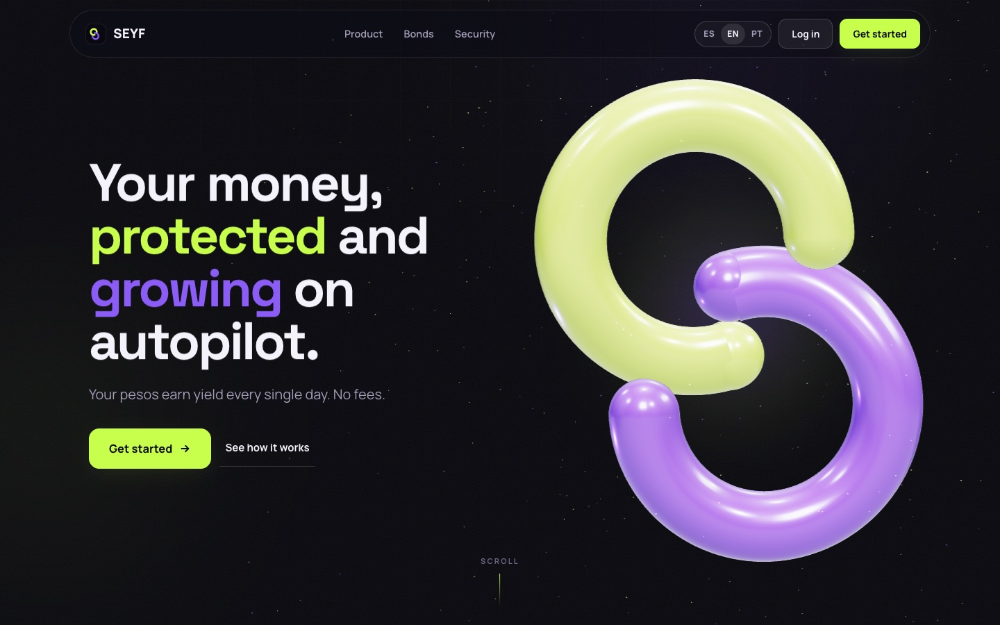
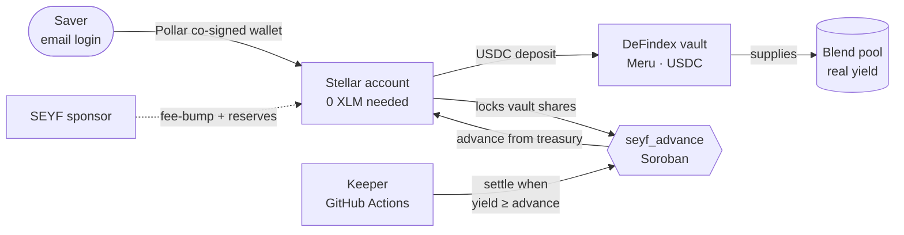
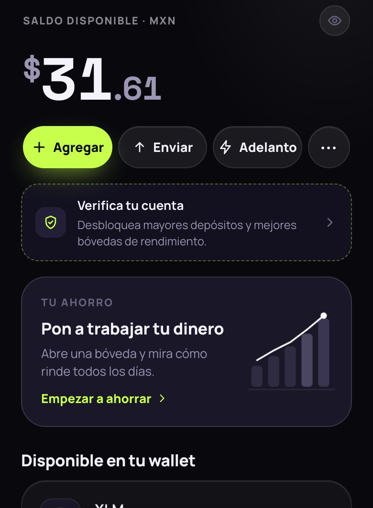
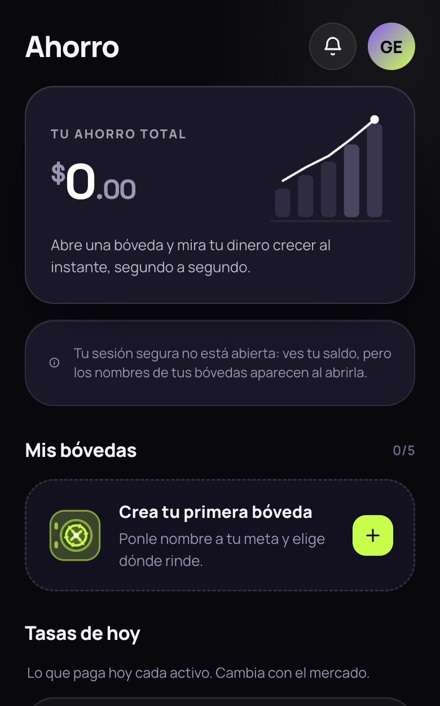
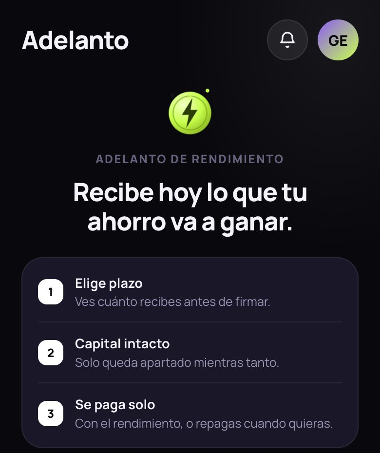
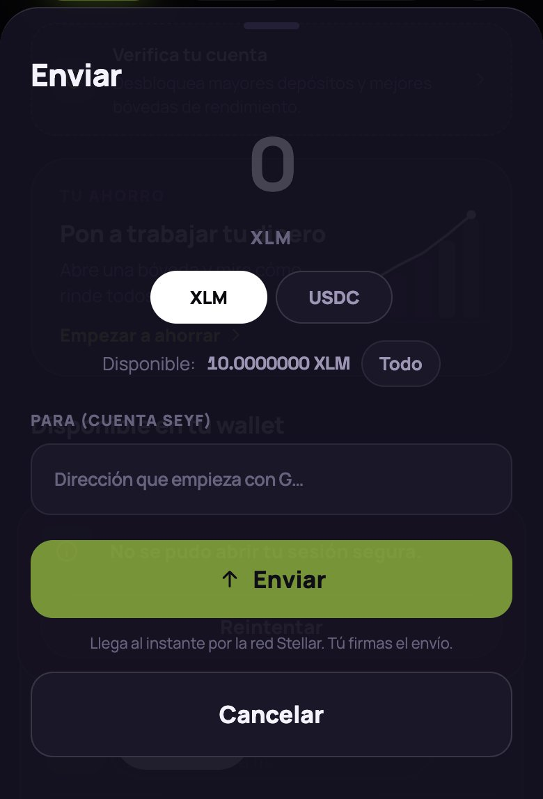

<div align="center">



# SEYF

### Savings that pay you today — on Stellar mainnet

**Save in USDC, earn real yield from Blend through a DeFindex vault, and get tomorrow's yield
advanced today by our Soroban contract. No seed phrase, no XLM for fees.**

[**Live app → www.seyf.app/app**](https://www.seyf.app/app) ·
[Landing](https://www.seyf.app) ·
[Contract on stellar.expert](https://stellar.expert/explorer/public/contract/CCZ77VBEZZIRBK3Z7RO4W227764G76ILXKO664R622FOSJTE7BX4CWXH) ·
[How it works](docs/how-it-works.md) ·
[Contract spec](docs/contracts.md) ·
[HackMeridian scorecard](docs/hackmeridian-2026.md) ·
[Español](README.es.md)


</div>

---

**HackMeridian 2026 · Category: Scale · Track: Stellar Composed** (two or more ecosystem projects
combined). Of this year's priorities, SEYF covers **smart contracts** (our own Soroban contract on
mainnet). It does not cover smart accounts: the wallet is a Pollar co-signed account, and the
passkey only recovers it. It does not cover cross-chain either.

## The problem

In Mexico, most people save in a bank account at ~0 % or in a retirement fund they never see.
Yield products exist, but they ask for things a regular saver doesn't have: a seed phrase, XLM to
pay fees, trustlines, a wallet extension. And even when savings do earn, the yield only arrives
later. Someone with an unexpected expense today has to break their savings.

## What SEYF does

1. **Sign in with an email.** [Pollar](https://pollar.xyz) creates a co-signed Stellar wallet
   (Turnkey 2-of-2). No seed phrase, no extension.
2. **Receive USDC.** The app enables the USDC trustline for you. Our sponsor pays the reserve and
   every fee with a fee-bump, so **the user never needs XLM**.
3. **Save in a vault.** USDC goes into a DeFindex USDC vault (Meru), which supplies it to a Blend
   lending pool. The balance grows every second on screen, anchored to the real on-chain value.
4. **Get an advance on your yield.** Our Soroban contract, `seyf_advance`, locks your vault shares
   and pays you today, from its own treasury, the yield they will earn over 1–30 days. Your
   principal is never touched:
   - **repay** early and everything unlocks at once; or
   - do nothing: once the real Blend yield covers the advance, a keeper calls **settle** and you
     get your full principal back.



## Live on mainnet: proof

Every step of the user journey has a mainnet transaction. Full tables: [`docs/contracts.md`](docs/contracts.md)
(English) · [`soroban/DEPLOYMENTS.md`](soroban/DEPLOYMENTS.md) (Spanish, with every hash).

| Step | Where | Transaction |
| --- | --- | --- |
| USDC trustline, sponsored (user keeps 0 XLM) | app, Pollar wallet | [d8d98a95…](https://stellar.expert/explorer/public/tx/d8d98a958538a4183878f65eaf0863650eec9b232db714870cceb466aca9a840) |
| Save 5 USDC in the DeFindex vault, supplied to Blend | app | [23572a98…](https://stellar.expert/explorer/public/tx/23572a98345f5973a144cd40422c22f815ac8d76b89e68e188cbcd8767a858d1) |
| `open_advance`: yield paid today from the contract treasury | app | [ab42eac9…](https://stellar.expert/explorer/public/tx/ab42eac9fbd19885cbe6f7fa47a035531ff794f387fd3f5a171ce0fb4586606c) |
| `repay`: early repayment, every share unlocked | app | [5cfd5592…](https://stellar.expert/explorer/public/tx/5cfd5592482eac2cdb08a077df8b7e40696e1b2c24d284e1aaef98445bf4da80) |
| `settle` by the keeper after **real Blend yield** covered the advance | GitHub Actions | [be77ba1e…](https://stellar.expert/explorer/public/tx/be77ba1e080e77d337c45b351226d535982bafb24be2fb9ef022ff58ec5e0e19) |
| Vault withdrawal pulled out of the Blend pool | CLI | [082bee22…](https://stellar.expert/explorer/public/tx/082bee220cdde1d072b6d7d8792a6e4d1b53ae152433ac31bd7e225824ec45de) |
| Contract deploy · treasury funded | CLI | [1fa79ed9…](https://stellar.expert/explorer/public/tx/1fa79ed90c90bf71063be5fbbdcc5fd30ea398d47d8dee7e3a12ff34cd6e540c) · [633b79df…](https://stellar.expert/explorer/public/tx/633b79df5073010cdc92a1a37766f92602f52169bda0ea2e69916bcf4ea40c8c) |

- **Contract:** `CCZ77VBEZZIRBK3Z7RO4W227764G76ILXKO664R622FOSJTE7BX4CWXH` · **Vault:** Meru
  `CCA2ZJP5BVRXYTQH4FAGHCAUMRYCXVC4CRYC2NXHWMR7TIVX36U7F5HR` · **USDC:** Circle
  `GA5ZSEJYB37JRC5AVCIA5MOP4RHTM335X2KGX3IHOJAPP5RE34K4KZVN`
- **SEP-1:** [`www.seyf.app/.well-known/stellar.toml`](https://www.seyf.app/.well-known/stellar.toml)
  publishes our SEP-10 signing key, the web-auth endpoint and the list of accounts we control.

> **Try it yourself.** The allowlist is off, so any account can open an advance. The beta caps are
> 1 USDC per user and 2 USDC in total, because the contract is not audited yet.

## The app

| Home | Savings (vaults) | Yield advance | Send |
| --- | --- | --- | --- |
|  |  |  |  |

The UI is in Mexican Spanish, because that's who it's for. The English walkthrough of every screen
and of what happens on-chain behind each button is in [**docs/how-it-works.md**](docs/how-it-works.md).

## Built on (Stellar Composed)

SEYF composes **five** ecosystem pieces instead of rebuilding them, and adds only one contract of
its own: the part that makes us different.

| Piece | Role in SEYF | Ours or reused |
| --- | --- | --- |
| **Soroban: `seyf_advance`** | Escrows vault shares and advances their yield from an in-contract treasury | **Ours** · [spec](docs/contracts.md) |
| **DeFindex** | Tokenized USDC vault (Meru) the user saves in | Reused |
| **Blend** | Lending pool where the vault earns real yield | Reused, through DeFindex |
| **Pollar** | Email login, co-signed embedded wallet, signing dialog | Reused |
| **Circle USDC + SAC** | The saved asset, moved by the contract through its Stellar Asset Contract | Reused |
| **SEP-10 · SEP-1 · fee-bump (CAP-15) · sponsored reserves (CAP-33)** | Session auth, discovery, gasless UX | Stellar primitives |

## Architecture

```
src/app/app            → the product (Next.js 16, React 19): Home · Savings · Advance tabs
src/app/retiro         → focused mainnet flow used during the event (same backend)
src/app/api/auth/sep10 → SEP-10 challenge/token (server signs with seyf-sep10-hot)
src/app/api/vault/*    → build deposit/withdraw XDR for the DeFindex vault; read position
src/app/api/advance/*  → quote, position, build open/repay/settle XDR for seyf_advance
src/app/api/stellar/sponsor/* → sponsored account, USDC trustline, fee-bumped submit (allowlisted ops, capped resourceFee)
src/app/api/db/*       → Supabase metadata (vault names, profile), gated by the SEP-10 session
soroban/seyf_advance   → the contract (Rust, soroban-sdk 29, 17 tests)
.github/workflows/keeper.yml → settles covered advances every 10 minutes
```

**Signing flow:** the server builds and simulates the transaction → Pollar shows it and the user
signs → the server wraps it in a fee-bump paid by the sponsor → Stellar RPC → poll until final.
The chain is the source of truth for balances. Supabase only stores labels such as vault names.

## Run it

```bash
npm install
cp .env.example .env.local      # Pollar key, Stellar network/RPC, contract + vault ids, Supabase (optional)
npm run dev                     # http://localhost:3000/app

cd soroban && cargo test        # 17 contract tests
stellar contract build          # wasm for deploy (Stellar CLI 28.1)
```

Without Supabase the app falls back to localStorage. The database schema is in
[`database/schema.sql`](database/schema.sql).

## Security and known limits

- `seyf_advance` is **not audited**. Mainnet runs with low caps, a pause switch that never blocks
  `repay` or `settle`, and no upgrade path.
- The vault (Meru) belongs to a third party and can be upgraded by a single key. Next step: our own
  non-upgradable DeFindex vault under a SEYF multisig.
- The sponsor only pays for allowlisted operations (the contract, the vault, the USDC SAC and the
  USDC trustline), with a capped `resourceFee`.
- Secrets live only on the server. The admin key lives in the OS secure store and never touches a
  server.

Details: [docs/contracts.md § Known limits](docs/contracts.md#known-limits-of-the-beta).

## What's next (SCF)

Target: the SCF Build Award, **Integration Track**
([details and requirements](docs/hackmeridian-2026.md#2-scf-eligibility)).

| Tranche | Deliverable |
| --- | --- |
| 1 | Our own non-upgradable DeFindex USDC vault (multisig roles), `cargo scout-audit` + STRIDE threat model for `seyf_advance` (prerequisites for the SCF Audit Bank) |
| 2 | MXN on/off-ramp via SPEI (Etherfuse, already integrated on testnet) and tokenized CETES |
| 3 | Raise caps after the audit, public launch in Mexico, on-chain metric: USDC NAV in the vault + advance volume |

## AI disclosure

HackMeridian allows AI-assisted development, and SCF asks for full disclosure. Parts of the code,
the contract tests and this documentation were written with an AI coding assistant (Claude Code),
with the team reviewing them. Every mainnet transaction linked here was signed by the team and
can be checked on stellar.expert.

## Team

Seyfert Labs. Built in Lisbon at HackMeridian 2026 on top of the existing SEYF app. What changed
during the event: [docs/hackmeridian-2026.md](docs/hackmeridian-2026.md#built-during-the-event).
