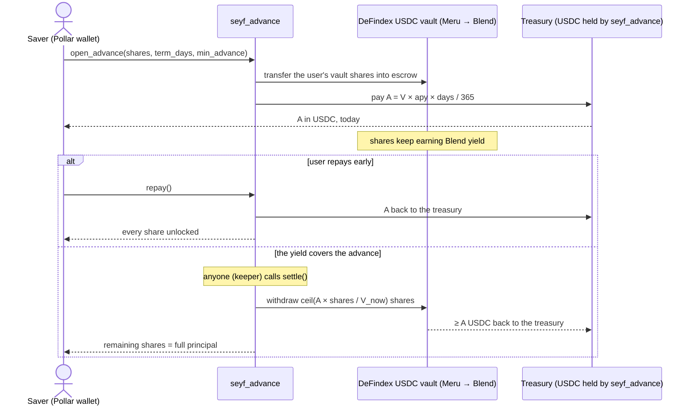

# `seyf_advance` — yield advance contract

> Source: [`soroban/seyf_advance`](../soroban/seyf_advance) · Deployments and every hash, in Spanish:
> [`soroban/DEPLOYMENTS.md`](../soroban/DEPLOYMENTS.md) · Plan: [`docs/hackmeridian-12h.md`](hackmeridian-12h.md)

## What it does

A saver who already holds shares of a DeFindex USDC vault can receive **today**, in USDC, the
yield those shares are expected to earn over a term (1–30 days in the mainnet beta).

- **The advance is paid from the contract's own treasury**, never from the vault or from the
  user's principal.
- The user's vault shares are **locked inside the contract** while the advance is open. They keep
  earning yield in the vault the whole time.
- There are **two ways out**:
  1. **`repay`**: the user returns the advance and gets every share back at once.
  2. **`settle`**: once the real yield covers the advance (`V_now ≥ V_open + A`), anyone can call
     it. Our keeper does it every 10 minutes. The contract withdraws only the shares worth `A`
     back to the treasury and returns the rest, the full principal, to the user.

## Rules it enforces

| Rule | How |
| --- | --- |
| The advance never comes from the user's principal | `open_advance` pays from `treasury()`, the contract's free USDC balance; the shares stay in escrow untouched |
| The treasury is the contract | `fund_treasury(from, amount)` lets anyone fund it. `withdraw_treasury(to, amount)` is admin-only and limited to the free balance: locked shares can't leave through it |
| Repaying early unlocks everything | `repay` returns `A` and every locked share, **even while paused** |
| Without repayment, shares stay locked until the yield covers the advance | `settle` fails with `YieldNotCovered` (#5) until `V_now ≥ V_open + A` |
| Principal is never touched on settlement | `settle` withdraws exactly the shares worth `A` (rounded up) and returns the rest |
| Pausing only stops new advances | `pause` blocks `open_advance`; `repay`, `settle` and the treasury keep working |
| No silent upgrades | There is no `upgrade` entry point; a change ships as a new deployment |

**Formulas**

- Advance: `A = floor(V × apy_bps × term_days / (10 000 × 365))`. It is capped by LTV
  (`max_advance_bps`), per user (`per_user_cap`) and globally (`global_cap`).
- Settlement: `ceil(A × locked_shares / V_now)` shares go to the treasury.
- `min_advance` protects the user from slippage: if the contract would pay less than what was
  quoted, the transaction fails.

## Interface

| Function | Caller | Effect |
| --- | --- | --- |
| `quote(shares, term_days) → (V, A)` | read | Same caps and errors as `open_advance` |
| `open_advance(user, shares, term_days, min_advance)` | user | Locks the shares and pays `A` from the treasury |
| `repay(user)` | user | Returns `A` and unlocks every share (also while paused) |
| `settle(user)` | anyone | Closes the position once the yield covers `A` (also while paused) |
| `position(user)` · `unlock_status(user) → (V_now, V_open + A)` | read | Open position and progress toward unlock |
| `treasury()` · `outstanding()` | read | Free USDC; total advances still open |
| `fund_treasury(from, amount)` | anyone | Adds USDC to the treasury |
| `withdraw_treasury(to, amount)` | admin | Withdraws from the free balance only |
| `set_params` · `pause` · `unpause` · `set_allowed` | admin | Parameters, pause switch, allowlist |
| `propose_admin` · `accept_admin` | admin → new admin | Two-step admin handover |

**Tests:** `cd soroban && cargo test` runs 17 tests against a mock vault with DeFindex's interface.
`soroban-sdk` 29.0.1 targets Protocol 29, the current mainnet protocol, checked with
stellar-raven on 2026-10-25. CI ([`contracts.yml`](../.github/workflows/contracts.yml)) runs the
tests and builds the wasm.

## Mainnet deployment (beta, 26 Oct 2026)

| Item | Value |
| --- | --- |
| Contract | [`CCZ77VBEZZIRBK3Z7RO4W227764G76ILXKO664R622FOSJTE7BX4CWXH`](https://stellar.expert/explorer/public/contract/CCZ77VBEZZIRBK3Z7RO4W227764G76ILXKO664R622FOSJTE7BX4CWXH) |
| Wasm hash | `64ae06cb3e50eb304b2eb8b7dc2be9f9271432b04d77b0f2a9eeded899e9bdfa`, the same wasm as testnet and as CI's build (only build metadata differs) |
| Vault | Meru, DeFindex USDC: `CCA2ZJP5BVRXYTQH4FAGHCAUMRYCXVC4CRYC2NXHWMR7TIVX36U7F5HR`. Strategy "USDC Autocompound Blend Fixed" on the Blend Fixed pool |
| Asset | Circle USDC `GA5ZSEJYB37JRC5AVCIA5MOP4RHTM335X2KGX3IHOJAPP5RE34K4KZVN`, SAC `CCW67TSZV3SSS2HXMBQ5JFGCKJNXKZM7UQUWUZPUTHXSTZLEO7SJMI75` |
| Parameters | `apy_bps` 50 (0.5 %, well under Meru's ~5 % measured net APY), `max_advance_bps` 500, term 1–30 days, cap 1 USDC per user and 2 USDC total |
| Allowlist | Turned off on 26 Oct at 05:23 UTC so judges can try it with their own accounts. The caps stay |

### Full cycle on mainnet, signed with the CLI

| Step | Result | Transaction |
| --- | --- | --- |
| Upload wasm | 22.36 XLM, almost the whole cost | [0170a085…](https://stellar.expert/explorer/public/tx/0170a085269d803862140bfe99616ee09d49f2d4e653dc69d4e5b07711b59655) |
| Deploy with constructor | admin, vault, asset and params read back and verified | [1fa79ed9…](https://stellar.expert/explorer/public/tx/1fa79ed90c90bf71063be5fbbdcc5fd30ea398d47d8dee7e3a12ff34cd6e540c) |
| `fund_treasury` (2 USDC) | `treasury()` = 20 000 000 | [633b79df…](https://stellar.expert/explorer/public/tx/633b79df5073010cdc92a1a37766f92602f52169bda0ea2e69916bcf4ea40c8c) |
| Deposit 5 USDC into Meru | the vault supplies it to Blend (pool `supply` event) | [fa4cc2eb…](https://stellar.expert/explorer/public/tx/fa4cc2eb5d4f5c0c2198a2ee3d53e8ebc9dc7860381d4523b9bce307d06961bb) |
| Withdraw from Meru | 1.0000014 USDC, pulled out of the Blend pool | [082bee22…](https://stellar.expert/explorer/public/tx/082bee220cdde1d072b6d7d8792a6e4d1b53ae152433ac31bd7e225824ec45de) |
| `open_advance`, 1 day | `V_open` = 39 999 998; advance 547 paid from the treasury | [de3d6629…](https://stellar.expert/explorer/public/tx/de3d6629638af6aea2e96784bfb135073c7b60022d3de47d2e990b0b8e7720dc) |
| `settle` by the keeper (GitHub Actions) | **real Blend yield** pushed `V` to 40 000 626 ≥ 40 000 545; position closed, `treasury()` back to 20 000 000 | [be77ba1e…](https://stellar.expert/explorer/public/tx/be77ba1e080e77d337c45b351226d535982bafb24be2fb9ef022ff58ec5e0e19) |
| `set_params`: allowlist off | same caps; any account can open an advance | [aea3eec0…](https://stellar.expert/explorer/public/tx/aea3eec00d6f6ea8346db6908f22df108882f745786250083e22c84eb12a7c8a) |

### Full cycle from the app (www.seyf.app/app, Pollar wallet)

User `GAG2HATHWNXEQEOHUNBDHPBI5P2E6QF2XTCV6ECKIWBJLYJIDGQSGRK2`: a 2-of-2 co-signed Pollar wallet
(Turnkey), created by signing in with an email. The user signed every step in Pollar's dialog. Our
sponsor paid every fee with a fee-bump, so **the user's account still holds 0 XLM**.

| Step | Result | Transaction |
| --- | --- | --- |
| Enable USDC | trustline sponsored by `seyf-sponsor-hot` | [d8d98a95…](https://stellar.expert/explorer/public/tx/d8d98a958538a4183878f65eaf0863650eec9b232db714870cceb466aca9a840) |
| Save 5 USDC in Meru | 46 063 753 vault shares; supplied to Blend | [23572a98…](https://stellar.expert/explorer/public/tx/23572a98345f5973a144cd40422c22f815ac8d76b89e68e188cbcd8767a858d1) |
| Ask for an advance (`open_advance`) | 0.0020547 USDC from the treasury to the user | [ab42eac9…](https://stellar.expert/explorer/public/tx/ab42eac9fbd19885cbe6f7fa47a035531ff794f387fd3f5a171ce0fb4586606c) |
| Repay (`repay`) | advance back to the treasury; shares unlocked | [5cfd5592…](https://stellar.expert/explorer/public/tx/5cfd5592482eac2cdb08a077df8b7e40696e1b2c24d284e1aaef98445bf4da80) |

When the position closed (06:24 UTC) it was worth 50 000 093, above the 50 000 004 deposited:
real Blend yield.

Each contract call costs 0.02–0.11 XLM.

### Testnet

Contract `CASAU3YCJQYXAVKNUTSHTH5F2DJVES7BM3QOVN4RD2NVAVLD2DRUM7ZI` ran the whole lifecycle on 25 Oct
against DeFindex's testnet USDC vault:

- `repay` while paused;
- `settle` rejected with `YieldNotCovered`, then accepted once yield arrived (simulated by donating
  USDC to the vault, because the testnet vault keeps its funds idle);
- `withdraw_treasury` over the free balance rejected with `InsufficientTreasury`.

Hashes in [`DEPLOYMENTS.md`](../soroban/DEPLOYMENTS.md#testnet-25-de-octubre-de-2026-tesorería-dentro-del-contrato).

## Keys and operations

| Role | Account | Where the key lives |
| --- | --- | --- |
| Admin | `GA7OITMN2PC55EPIMQL5SWX6ZGT55HEHJEIC7FDAHCZWCPLFZZ5N6V7U` | OS secure store (`stellar keys generate --secure-store`), not exportable, never on a server |
| Keeper (pays `settle` only) | `GAYVVUKEUZQ76FYKORZNQL2S3HU56VSFSBE4KTPJXCLASB3XELHXTSC3` | GitHub Actions secret, minimal balance |
| Fee and reserve sponsor | `GDPVVG4AWVXDS6WBS4PEBGH7UVJKFJUKC26UVBCG7LYIYIM3S6EQHB72` | Vercel, minimal balance |
| SEP-10 challenge signer (no funds) | `GCICR4ID7D6MSU4N7ZST3U7YCSRO6YCDOUKWAYZHHR6JD4BWKC46LQ5E` | Vercel; published in [`stellar.toml`](https://www.seyf.app/.well-known/stellar.toml) |

The keeper is [`.github/workflows/keeper.yml`](../.github/workflows/keeper.yml), which runs every
10 minutes plus manual dispatch. It scans `open_advance` events and calls `settle` on positions whose
yield already covers the advance. Its first live settle is
[run 40268641108](https://github.com/Seyfert-Labs/SEYF-P/actions/runs/40268641108).

> ⚠️ Look-alike accounts that mimic these addresses, with the same first and last characters, sent
> dust transactions to poison the history. Use only this table or `stellar.toml`.

## Known limits of the beta

| Risk | Mitigation |
| --- | --- |
| `seyf_advance` is **not audited** | Caps of 1 USDC per user and 2 USDC total, pause switch, no upgrade path. `repay` and `settle` keep working while paused. Audit planned through the SCF Audit Bank |
| Meru is a third-party vault, upgradable by a single-signer admin | Low caps. Next step: our own non-upgradable DeFindex vault with roles under a SEYF multisig |
| Meru can rebalance into a second strategy (Blend YieldBlox) | Check `fetch_total_managed_funds` before demos; pause if the allocation changes |
| The Blend Fixed pool is On-Ice (no new borrows, ~74 % utilization) | A withdrawal out of the pool was tested on mainnet ([082bee22…](https://stellar.expert/explorer/public/tx/082bee220cdde1d072b6d7d8792a6e4d1b53ae152433ac31bd7e225824ec45de)) |
| APY can drop | `apy_bps` set at a tenth of the measured APY; the admin can lower it with `set_params` |

Older contract: `seyf-lock` (date-based unlock, treasury pool) is archived in the
`archive/seyf-lock` branch. It was replaced because it unlocked on a date even when yield fell short,
and because it required new USDC instead of locking savings the user already had.
