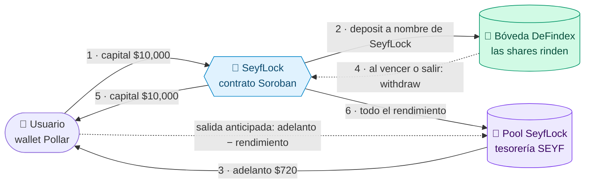
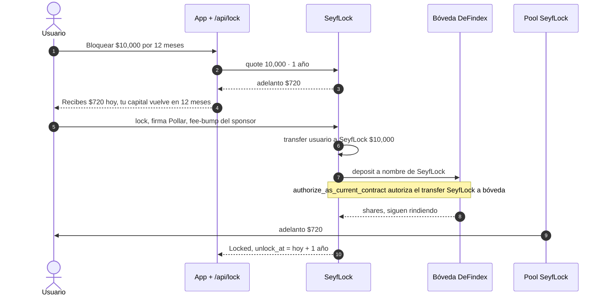
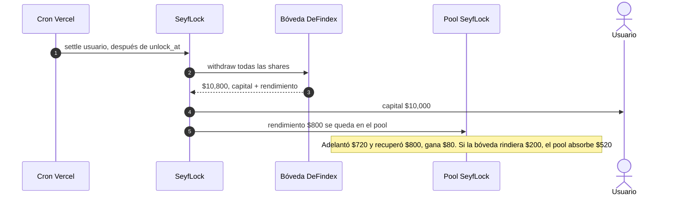
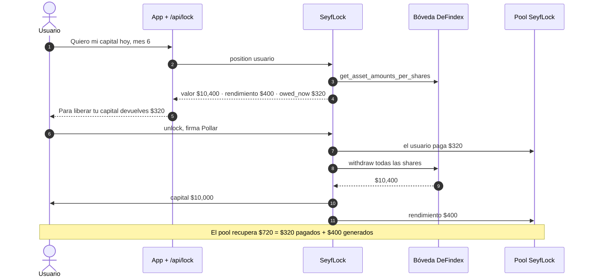
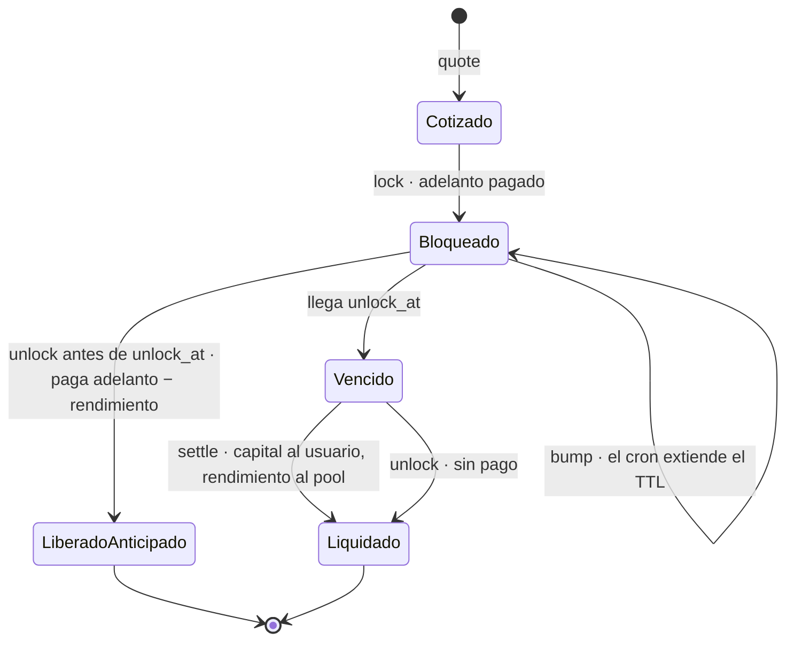

# SEYF × HackMeridian 2026 — plan de ejecución

> Rama: `meridian` (nunca `main`). Repo público: github.com/Seyfert-Labs/SEYF-P
> Antes de empezar: `SOUL.md` y `docs/seyf-context.md` (los 4 checks).
> Fuente de verdad Stellar: **stellar-raven**. Nada de direcciones ni APIs de memoria.
> **Arranque (T0): cuando se mergee el PR del colaborador.** Rebasar `meridian` antes de B0.

## Contexto verificado (Raven, 2026-10-25)

| Dato | Valor |
|---|---|
| Hacking | dom 25-oct 09:00 → **lun 26-oct 12:00 (Lisboa)**. Sin entregas tardías |
| Categoría | **Scale**. Se juzga: hitos vs. metas del intake, elegibilidad SCF, *production readiness*, impacto |
| Track | **Stellar Composed**: **SeyfLock (Soroban propio)** + DeFindex + Soroswap + Pollar + Etherfuse + SEP-10/CAP-33 |
| Prioridades del evento | smart contracts, **smart accounts**, cross-chain |
| Entregables | video demo, pitch deck, repo GitHub, formulario |
| Red | Mainnet **Protocol 29**; `@stellar/stellar-sdk` 16.4.1 (repo en 14.6) |
| Fee sponsorship | Launchtube retirado → OpenZeppelin Relayer / Stellar Channels |
| Horizon | fin de vida → Stellar RPC |
| USDC mainnet | `GA5ZSEJYB37JRC5AVCIA5MOP4RHTM335X2KGX3IHOJAPP5RE34K4KZVN` |
| Soroban | `soroban-sdk` **29.0.1** (la versión mayor sigue al protocolo); Stellar CLI **28.1**. OZ Stellar contracts 0.8 exige SDK 28 → no se usa |
| DeFindex | Contratos movidos a `defindex-io/stellar-contracts` (`paltalabs/defindex` archivado). Auditoría OtterSec 2025-03. Mainnet tiene estrategia **CETES** (`cetes_blend_autocompound_etherfuse_strategy`) y USDC. Interfaz de la bóveda verificada en código: `deposit(amounts_desired, amounts_min, from, invest)`, `withdraw(df_amount, min_amounts_out, from)`, `get_asset_amounts_per_shares(shares)`; las shares son token SEP-41 del propio contrato |

## Decisiones

1. **Reflector se elimina.** Precios: Etherfuse (CETES) + Soroswap quote vía USDC; Bitso ticker público solo como respaldo MXN/USD.
2. **Pollar es el único login + wallet** (cuenta G).
3. **Etherfuse es la única rampa MXN.** Bóvedas = **DeFindex**.
4. **Lo EVM se archiva en git, no en carpeta.** Tag `evm-final` + rama `archive/evm` en el último commit con EVM; `docs/legacy-evm.md` explica qué había y dónde quedó. En `meridian` se quita del árbol: Privy, viem, permissionless, ox, Juno, Bitso-órdenes, Dynerox, `chain.ts`, `contracts/` (Solidity, incl. `SeyfVaults.sol` y `SeyfAdvance.sol`), Reflector.
5. **Adelanto de rendimiento = `SeyfLock`** (contrato Soroban propio en `soroban/seyf-lock`), reemplaza a `SeyfAdvance.sol`. **Sin Trustless Work**: no puede depositar en DeFindex, no tiene time-lock y congela montos al fondear. Diseño en §SeyfLock.
   - Si el rendimiento real es menor que el adelanto → **lo absorbe la tesorería** (pool de SeyfLock).
   - Salida anticipada → **el rendimiento generado regresa a la tesorería** y el usuario paga `adelanto − rendimiento` (mínimo 0) para liberar su capital.
6. **Mainnet honesto:** lo que exista en mainnet corre en mainnet con hash de evidencia; lo demás en testnet y se declara.
7. **Passkeys (Smart Account Kit)** = stretch.

## SeyfLock — capital bloqueado en DeFindex + adelanto del rendimiento futuro

Contrato: `soroban/seyf-lock` (Rust, `soroban-sdk` 29.0.1). Reemplaza a `SeyfAdvance.sol` y porta su
lógica (`capital × APY × plazo`, tope 90% del capital) agregando vencimiento y salida anticipada.

### Reglas

| Momento | Qué pasa |
|---|---|
| **Bloquear** (`lock`) | El usuario manda su capital a SeyfLock; SeyfLock lo **deposita en la bóveda DeFindex a su nombre** (las shares siguen rindiendo) y le paga el **adelanto** desde el pool: `capital × APY × plazo × 90%` |
| **Al vencer** (`settle`, lo llama cualquiera: el cron) | El usuario recibe su **capital completo**; **todo el rendimiento va al pool**. Si el rendimiento fue menor que el adelanto, **el pool (tesorería SEYF) absorbe la diferencia** |
| **Salida anticipada** (`unlock`) | El **rendimiento generado regresa al pool** y el usuario paga lo que falte del adelanto: `adelanto − rendimiento` (mínimo 0). Recibe su capital completo |
| **Pérdida de la bóveda** | Si DeFindex vale menos que el capital, el usuario recibe lo que haya; el pool no cubre pérdidas de capital |
| **Pausa** (`set_paused`) | Frena bloqueos nuevos. **`unlock` y `settle` nunca se pausan**: el capital no puede quedar atrapado |
| **Pool** (`fund_pool` / `withdraw_pool`) | Es el saldo libre del activo en SeyfLock. El capital bloqueado vive como shares, así que el admin **no puede tocarlo** |

**Ejemplo** (APY 8%, adelanto al 90%): bloqueas **$10,000 por 1 año** → recibes hoy **$720**.

### 1. Mapa del dinero



### 2. Bloquear y recibir el adelanto



### 3. Vencimiento — el cron liquida



### 4. Salida anticipada — devolver para liberar



### 5. Estados de un bloqueo



### Verificado

- **16 tests** (`cd soroban && cargo test`): cotización, bloqueo, autorización solo con la firma del usuario (validado quitando `authorize_as_current_contract`: falla con `Error(Auth, InvalidAction)`), vencimiento, faltante absorbido, salida anticipada con y sin rendimiento, pérdida de la bóveda, pausa, topes, pool aislado del capital.
- **E2E en testnet contra la bóveda DeFindex real** (XLM vault `CCLV4H7W…GFSF6`), SeyfLock `CC5CLKMAJU7KHMUUJWXM7RJ6E7OCN6LPI66GPL26LJMH7YDTAU6XQ6BZ`:
  - lock 1,000 XLM / 1 año → adelanto 72 XLM — [tx](https://stellar.expert/explorer/testnet/tx/96cb232a0831c4dacc069830cec5295f9698f593d6e2160656bd8acc7e3903f7)
  - salida anticipada: devuelve 72 XLM, recupera el capital — [tx](https://stellar.expert/explorer/testnet/tx/e10a9b373670dfd89c3faf19d00168dc9b6285547c2f2df4e592d486b105bfc8)
  - `settle` antes del vencimiento → `Error(Contract, #7) NotMatured` ✅
  - `settle` al vencer (bloqueo de 60 s), **firmado por un tercero** (admin): capital al usuario, el pool absorbe el adelanto porque la bóveda de testnet no rindió — [tx](https://stellar.expert/explorer/testnet/tx/06b2e1b561e599f0d0af84d89ff36bb376ebcf0eca33fa10fa99bcf894feb463)
  - Redondeo de shares de DeFindex: 9 stroops en un ciclo de 1,000 XLM.

### Pendiente

- [ ] `/api/lock/*` + UI + cron (`settle` / `bump`) — B3
- [ ] Direcciones de bóvedas DeFindex en **mainnet** (CETES/USDC) y despliegue con topes — B4
- [ ] `apy_bps` lo fija el admin; actualizarlo con el APY real de la bóveda (DeFindex API) antes de cotizar
- [ ] Auditoría (SCF Audit Bank) antes de subir topes

## Bloques (duraciones; T0 = merge del PR)

| # | Duración | Bloque | Hecho cuando |
|---|---|---|---|
| B0 | 0:30 | Rebase sobre el PR, metas del intake, **archivo EVM** (tag + rama + `docs/legacy-evm.md`) | tag y rama en origin |
| B1 | 1:00 | **Red al día:** quitar Reflector, stellar-sdk 16.x | `npm run build` exit 0 |
| B2 | 5:00 | **Fuera EVM:** WalletContext sobre Pollar, recablear modales | grep EVM en `src/` = 0; build verde; login→home→depósito→bóveda→swap→envío en testnet |
| B3 | 3:00 | **SeyfLock en la app:** contrato ✅ (16 tests + E2E testnet); falta `/api/lock/*`, UI y cron de `settle` | bloquear → adelanto → salida/vencimiento desde la app en testnet |
| B4 | 2:30 | **Mainnet:** env, sponsor fondeado, `check:mainnet` verde, **SeyfLock desplegado con topes bajos**, txs reales | hashes en README §Mainnet |
| B5 | 2:00 | Landing + pulido | landing en Vercel prod |
| B6 | 3:00 | README, deck, video ≤3 min | 3 entregables |
| B7 | 1:00 | Entrega + buffer | enviado antes de 11:30 Lisboa |

**Total ≈ 18 h.** Regla de recorte (se decide en T0):

| Si T0 es… | Recorte |
|---|---|
| antes de 16:00 | plan completo, 4 h de sueño |
| 16:00–19:00 | B5 queda en pulido mínimo; escrow en mainnet se cae |
| después de 19:00 | escrow solo testnet y demo de adelanto; sin landing nueva; mainnet solo SEP-10 + cuenta patrocinada + swap |

## Mapa de cambios B2 (pantalla → riel Stellar)

| Hoy (EVM) | Queda (Stellar) |
|---|---|
| `Providers.tsx` + `PrivyBridge` + `SmartWalletsProvider` | `SeyfPollarProvider` + `StellarWalletBridge` que llena `WalletCtx` |
| `WalletState.sendMXNB / sendTx / smartAddress` | `sendPayment(to, asset, amount)` con fee-bump; `address` = G… |
| `useOnchain` (MXNB) | saldos XLM/USDC/CETES por RPC |
| `DepositModal` / `ClabeCard` (Juno) | Etherfuse deposit-info + onramp |
| `RedeemModal` (Juno) | offramp Etherfuse (reusar Regional Starter Pack si falta) |
| `AddBankModal` (Juno) | `/api/seyf/etherfuse/bank-account` |
| `SendModal` (MXNB) | pago Stellar (`/api/stellar/pay/build` + `sponsor/submit`) |
| Conversión FX (`/api/convert`) | Soroswap (`/api/swap/*`) |
| `WelcomeBonus` | onboarding patrocinado (cuenta + trustlines gratis) |
| `LiquidityAdvanceModal` / `RepayModal` / `useAdvance` | **SeyfLock** vía `/api/lock/*` (B3) |
| `usePendingTxns` | operaciones de la cuenta Stellar |

Quitar del árbol (queda en `archive/evm`): `src/app/api/{juno,bitso/convert,convert,treasury,dynerox}`, `src/lib/{juno,chain.ts,dynerox,bitso/orders.ts}`, `src/services/junoService.ts`, `src/types/juno.ts`, `src/hooks/useJuno.ts`, `src/components/wallet/PrivyBridge.tsx`, `contracts/`, `src/lib/stellar/reflector.ts`, `src/app/api/prices/reflector`, `Untitled`. Deps: `@privy-io/react-auth`, `viem`, `permissionless`, `ox`.

## Metas (pegar las del intake)

- [ ] …

## Riesgos

1. stellar-sdk 16 vs Pollar/Soroswap/DeFindex (peer deps) — validar en B1.
2. No exista vault CETES de DeFindex en mainnet → decisión 6.
3. Pollar sin soporte mainnet → la evidencia mainnet usa una cuenta de prueba, y se declara.
4. SeyfLock **sin auditoría** en mainnet → topes `cap_per_lock`/`cap_total` bajos + `set_paused`; auditoría vía SCF Audit Bank.
6. Bloqueos > ~6 meses superan el TTL máximo de un entry → el cron llama `bump` (y desde Protocol 23 lo archivado se restaura, no se pierde).
5. Tiempo → regla de recorte.

---

## MASTER PROMPT

Pega esto en una sesión nueva de Claude Code abierta en `Seyf2/` (o úsalo como checklist).

```text
Eres el ingeniero principal de SEYF en HackMeridian 2026 (categoría Scale, track Stellar Composed).
Deadline duro: lunes 26-oct-2026 12:00 hora de Lisboa. Optimiza para entregar, no para perfección.

ANTES DE EMPEZAR
- Lee SOUL.md, docs/seyf-context.md (4 checks) y docs/hackmeridian-plan.md (este plan).
- Si .claude/skills/ está vacío: `bash scripts/install-stellar-skills.sh`. Usa los skills
  instalados (dapp, data, assets, standards, pollar-wallet-auth, defindex-sdk, soroswap-sdk,
  stellar-anchors, smart-contracts, deploy-stellar-mainnet) y reusa lo de §Check 4 antes de
  escribir código nuevo.
- `git pull --rebase` en `meridian` (incluye el PR del colaborador). Aplica la regla de recorte según la hora.

REGLAS
- SOLO rama `meridian`. Nunca `main`. Commits pequeños por bloque, en español (feat/fix/chore).
- Hechos de Stellar (direcciones C…/G…, APIs, versiones, SEPs, endpoints de Soroswap/DeFindex/
  Etherfuse/Pollar/DeFindex, OZ Relayer) se verifican con stellar-raven. Si no se confirma:
  a env y marcado como pendiente.
- Secretos solo server-side. No leas ni imprimas .env.
- Reglas de CLAUDE.md (store.ts decide Supabase/localStorage; Supabase solo en lib/supabase;
  las screens solo usan useWallet()).
- Gate de cada bloque: `npm run build` exit 0. Lo que no quepa se oculta tras flag, nunca roto.
- Si cambias una decisión, actualízala en docs/hackmeridian-plan.md.

BLOQUES (reporta al terminar cada uno: qué cambió y cómo se verificó)
B0 Archivo EVM: `git tag evm-final` + `git branch archive/evm` en el HEAD actual, push de ambos;
   escribe docs/legacy-evm.md (qué había, tag/rama, por qué se quitó).
B1 Red al día: elimina Reflector (lib, ruta, uso en /api/prices/mxn, .env.example, docs, stellar.toml).
   Con Raven, notas de js-stellar-sdk 15→16 y peer deps; sube a 16.x si es compatible, si no fija y anota.
B2 Fuera EVM: WalletState para Stellar + StellarWalletBridge sobre Pollar; quita Privy; recablea
   según "Mapa de cambios B2"; quita la lista "Quitar del árbol" y las deps EVM; actualiza CLAUDE.md,
   README.md y .env.example a full Stellar.
   Verifica: grep -riE "privy|viem|arbitrum|mxnb|juno|permissionless" src = 0; build verde;
   recorre login→home→depósito→bóveda→swap→envío en testnet.
B3 SeyfLock en la app (contrato ya hecho: soroban/seyf-lock, 16 tests, E2E testnet en
   soroban/scripts/testnet-e2e.sh). Falta: /api/lock/{quote,build,submit,position} (server arma el
   XDR, el usuario firma con Pollar, fee-bump del sponsor), recablear LiquidityAdvanceModal/
   RepayModal/useAdvance a SeyfLock (bloquear con plazo, ver adelanto, salida anticipada con
   owed_now), y cron de Vercel que llame settle/bump en bloqueos vencidos. Tras
   NEXT_PUBLIC_FEATURE_ADVANCE.
B4 Mainnet: con Raven confirma vaults DeFindex (¿CETES?), CETES/MXNe de Etherfuse, Pollar mainnet,
   Soroswap mainnet. Completa stellar.toml; `npm run check:mainnet` verde. Despliega SeyfLock en
   mainnet contra la bóveda DeFindex (CETES o USDC) con topes bajos y pool fondeado. Evidencia
   on-chain: SEP-10, create-account patrocinada, trustline USDC, swap, lock + unlock. Hashes en README.
   Sigue el skill deploy-stellar-mainnet (3 gates).
B5 Landing + pulido: "ahorro en CETES y dólares, sin seed phrase ni comisiones, sobre Stellar";
   sección "Construido con" (SeyfLock en Soroban, DeFindex, Soroswap, Pollar, Etherfuse, SEP-10, CAP-33);
   CTA a /app; sin "banco/neobank". App sin mocks en el flujo demo.
B6 Entregables: README EN+ES (problema, demo, diagrama, qué es Stellar-native, evidencia mainnet,
   cómo correrlo, roadmap SCF #46 en 3 tranches); guion de video ≤3 min y deck de 10 slides en docs/.
   Usa scf-submission-drafter / scf-prescreen-checker.
   Stretch: passkeys (Smart Account Kit + OZ Relayer) detrás de flag.

AL FINAL: qué quedó en mainnet, qué en testnet, qué se ocultó, riesgos abiertos.
```
