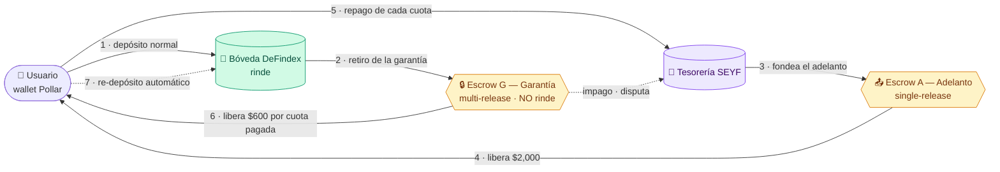
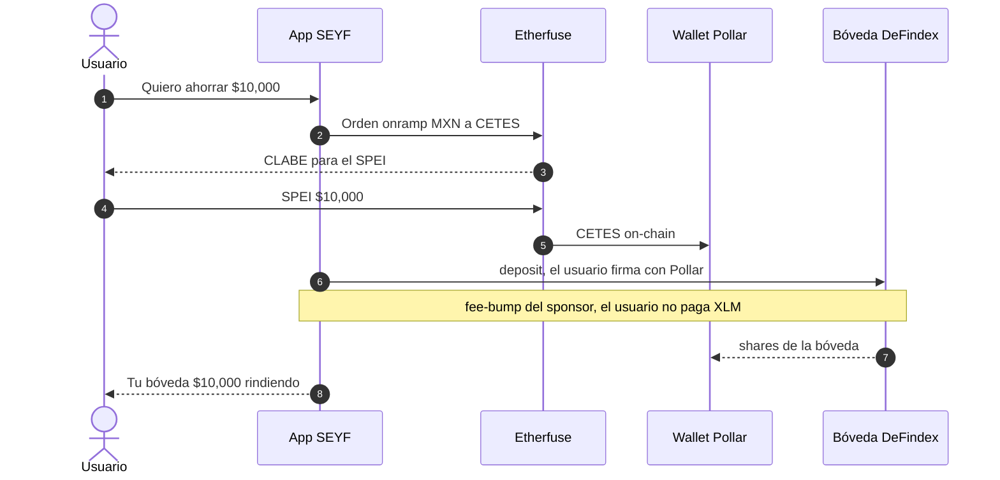
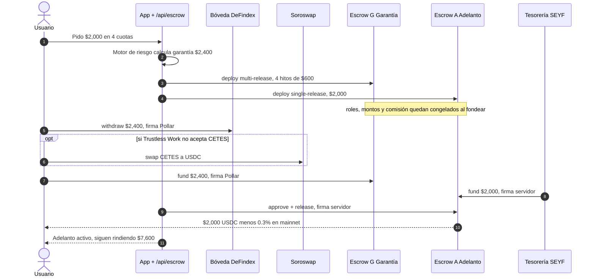
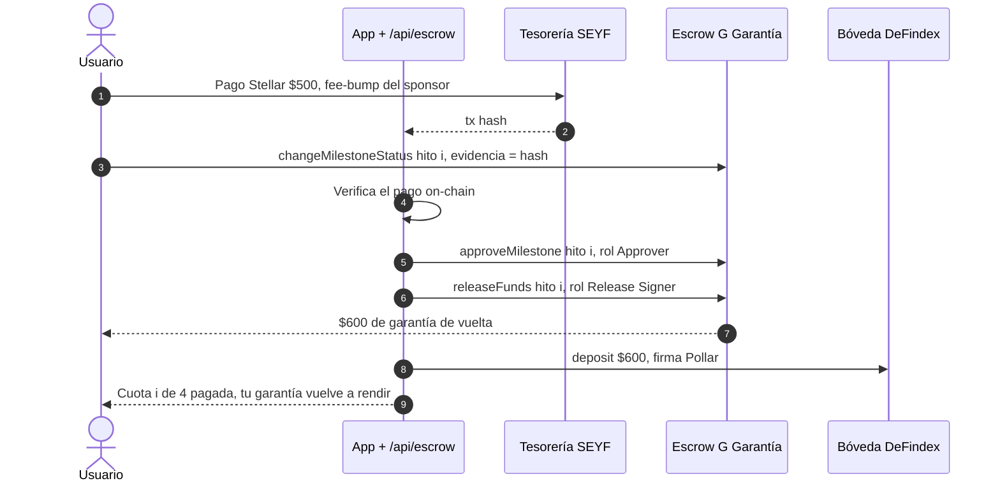
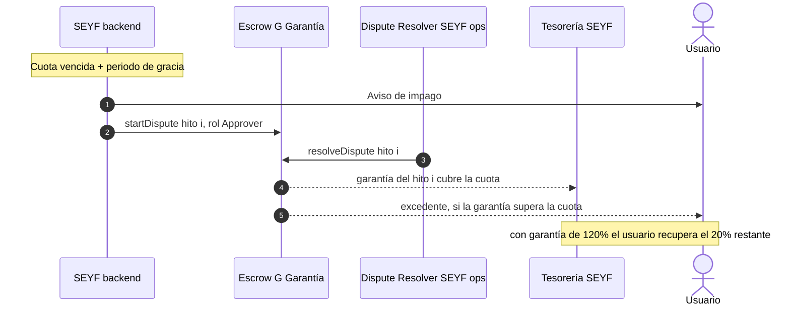
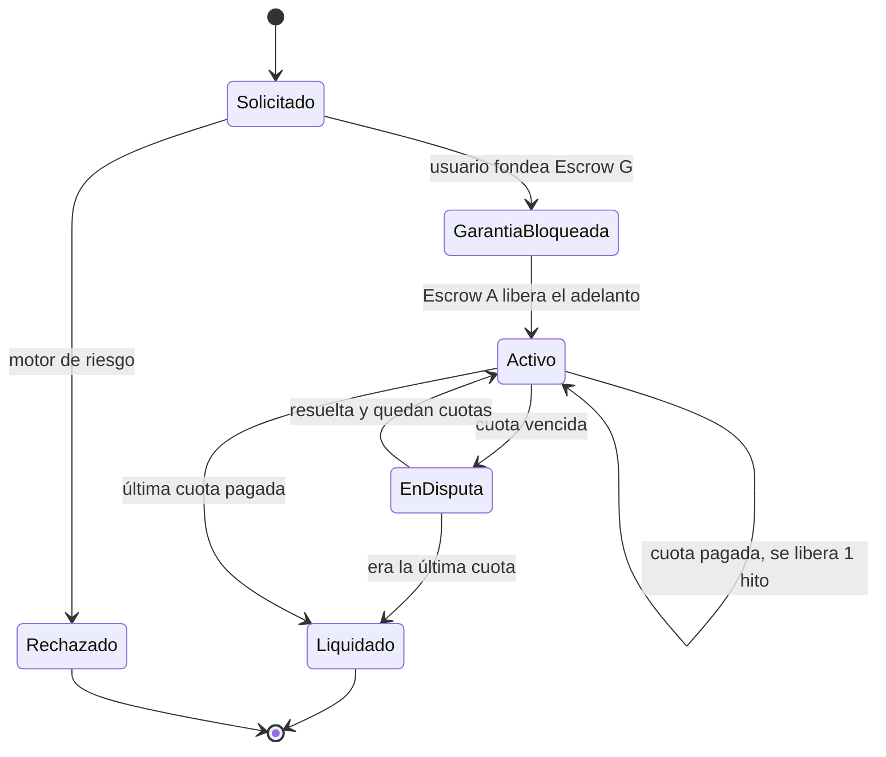

# SEYF × HackMeridian 2026 — plan de ejecución

> Rama: `meridian` (nunca `main`). Repo público: github.com/Seyfert-Labs/SEYF-P
> Antes de empezar: `SOUL.md` y `docs/seyf-context.md` (los 4 checks).
> Fuente de verdad Stellar: **stellar-raven**. Nada de direcciones ni APIs de memoria.
> **Arranque (T0): cuando se mergee el PR del colaborador.** Rebasar `meridian` antes de B0.

## Contexto verificado (Raven, 2026-10-25)

| Dato | Valor |
|---|---|
| Hacking | dom 25-oct 09:00 → **lun 26-oct 12:00 (Lisboa)**. Sin entregas tardías |
| Categoría | **Scale**. Se juzga: hitos vs. metas del intake, elegibilidad SCF, *production readiness*, impacto |
| Track | **Stellar Composed**: Pollar + DeFindex + Soroswap + Etherfuse + **Trustless Work** + SEP-10/CAP-33 |
| Prioridades del evento | smart contracts, **smart accounts**, cross-chain |
| Entregables | video demo, pitch deck, repo GitHub, formulario |
| Red | Mainnet **Protocol 29**; `@stellar/stellar-sdk` 16.4.1 (repo en 14.6) |
| Fee sponsorship | Launchtube retirado → OpenZeppelin Relayer / Stellar Channels |
| Horizon | fin de vida → Stellar RPC |
| USDC mainnet | `GA5ZSEJYB37JRC5AVCIA5MOP4RHTM335X2KGX3IHOJAPP5RE34K4KZVN` |
| Trustless Work | V1 en mainnet (V2 solo testnet). Auditado por Runtime Verification (2025-09-12). Repo de contratos activo, repoScore 85. API `https://api.trustlesswork.com` / `https://dev.api.trustlesswork.com`, header `x-api-key`, 50 req/min. Fee 0.3% al liberar (mainnet) |

## Decisiones

1. **Reflector se elimina.** Precios: Etherfuse (CETES) + Soroswap quote vía USDC; Bitso ticker público solo como respaldo MXN/USD.
2. **Pollar es el único login + wallet** (cuenta G).
3. **Etherfuse es la única rampa MXN.** Bóvedas = **DeFindex**.
4. **Lo EVM se archiva en git, no en carpeta.** Tag `evm-final` + rama `archive/evm` en el último commit con EVM; `docs/legacy-evm.md` explica qué había y dónde quedó. En `meridian` se quita del árbol: Privy, viem, permissionless, ox, Juno, Bitso-órdenes, Dynerox, `chain.ts`, `contracts/` (Solidity, incl. `SeyfVaults.sol` y `SeyfAdvance.sol`), Reflector.
5. **Adelanto de liquidez = Trustless Work** (escrow on-chain), reemplaza a `SeyfAdvance.sol`. Diseño en §Escrow.
6. **Mainnet honesto:** lo que exista en mainnet corre en mainnet con hash de evidencia; lo demás en testnet y se declara.
7. **Passkeys (Smart Account Kit)** = stretch.

## Escrow — adelanto, bloqueo y repagos con Trustless Work

### Lo que impone el modelo de Trustless Work (y cambia el diseño)

- **Lo que está en escrow no rinde.** El dinero queda en el contrato de escrow, no en DeFindex. Por eso **la bóveda normal no pasa por el escrow**: solo entra la porción bloqueada como garantía mientras hay un adelanto vivo.
- **Un escrow va en una sola dirección** (depositante → receptor), y al fondearse se congelan roles, montos y comisión. Por eso adelanto y garantía son **dos escrows distintos**, y los repagos se modelan como **hitos**.
- **Activo:** USDC está documentado. CETES no está confirmado → la garantía va en USDC hasta verificarlo (`constitution.md` del skill).

### Diseño

**Ejemplo que usan todos los diagramas** (números ilustrativos; el % de garantía está por definir):
el usuario tiene **$10,000** en su bóveda y pide un adelanto de **$2,000** pagadero en **4 cuotas de $500**.
Se bloquea una garantía de **$2,400 (120%)** dividida en 4 hitos de **$600**.

#### 1. Mapa del dinero — quién tiene qué



Regla de oro: **lo verde rinde, lo amarillo no.** Solo se mueve a amarillo lo mínimo y por el tiempo mínimo.

#### 2. Depósito normal a la bóveda (sin escrow)



#### 3. Pedir el adelanto — bloqueo + desembolso



#### 4. Pagar una cuota — repago + desbloqueo + re-depósito



#### 5. Impago — disputa y resolución



#### 6. Estados de un adelanto



Cada estado se guarda en `advance_sessions` con los IDs de Escrow A y G, así la app y el on-chain siempre se pueden cuadrar.

| Rol (V1) | Escrow A — Adelanto | Escrow G — Garantía |
|---|---|---|
| Depositante | Tesorería SEYF | Usuario (sale de su bóveda) |
| Service Provider (marca estado + evidencia) | SEYF backend | **Usuario** (marca "cuota pagada" con el hash) |
| Approver | SEYF motor de riesgo | SEYF backend (verifica el pago on-chain) |
| Release Signer | SEYF | SEYF |
| Receiver | Usuario | Usuario (recupera la garantía por tramos) |
| Dispute Resolver | SEYF ops (luego un tercero neutral) | SEYF ops (luego un tercero neutral) |
| Platform Address | SEYF (comisión 0%) | SEYF (comisión 0%) |

- **Entrada a la bóveda:** cuando Escrow G libera el hito i, el backend vuelve a depositar ese tramo en DeFindex. Así el escrow gestiona la salida (bloqueo) y la re-entrada (desbloqueo).
- **Impago:** SEYF abre una disputa en Escrow G → el resolver asigna a la tesorería la garantía de las cuotas pendientes.
- **Llaves nuevas (server-side):** `SEYF_ESCROW_SIGNER_SECRET` (approver/release signer), separada del sponsor. `TRUSTLESS_WORK_API_KEY`.
- **Datos:** `advance_sessions` + columnas `escrow_advance_id`, `escrow_collateral_id`, `repayment_tx_hashes`.
- **Código:** SDK `@trustless-work/escrow` (React hooks) o la API REST desde route handlers `/api/escrow/*` (server firma los roles de SEYF; el usuario firma con Pollar los suyos). Skill `trustless-work` instalado.

### Por verificar antes de codear (Raven + skill)

- [ ] Activos admitidos en V1 (¿solo USDC? ¿cualquier activo clásico con trustline?)
- [ ] `withdrawRemainingFunds`: quién lo llama y cuándo (issue #117 del contrato)
- [ ] Si el usuario puede ser Service Provider de su propio escrow sin conflicto con la disputa
- [ ] Costo en mainnet: 0.3% al liberar → ¿lo absorbe SEYF en el adelanto?

## Bloques (duraciones; T0 = merge del PR)

| # | Duración | Bloque | Hecho cuando |
|---|---|---|---|
| B0 | 0:30 | Rebase sobre el PR, metas del intake, **archivo EVM** (tag + rama + `docs/legacy-evm.md`) | tag y rama en origin |
| B1 | 1:00 | **Red al día:** quitar Reflector, stellar-sdk 16.x | `npm run build` exit 0 |
| B2 | 5:00 | **Fuera EVM:** WalletContext sobre Pollar, recablear modales | grep EVM en `src/` = 0; build verde; login→home→depósito→bóveda→swap→envío en testnet |
| B3 | 3:00 | **Escrow Trustless Work (testnet):** adelanto + garantía + repago | demo de punta a punta en testnet con IDs de los escrows |
| B4 | 2:30 | **Mainnet:** env, sponsor fondeado, `check:mainnet` verde, txs reales (incluido un escrow si da el tiempo) | hashes en README §Mainnet |
| B5 | 2:00 | Landing + pulido | landing en Vercel prod |
| B6 | 3:00 | README, deck, video ≤3 min | 3 entregables |
| B7 | 1:00 | Entrega + buffer | enviado antes de 11:30 Lisboa |

**Total ≈ 18 h.** Regla de recorte (se decide en T0):

| Si T0 es… | Recorte |
|---|---|
| antes de 16:00 | plan completo, 4 h de sueño |
| 16:00–19:00 | B5 queda en pulido mínimo; escrow en mainnet se cae |
| después de 19:00 | escrow solo testnet y demo de adelanto; sin landing nueva; mainnet solo SEP-10 + cuenta patrocinada + swap |

## Mapa de cambios B2 (pantalla → riel Stellar)

| Hoy (EVM) | Queda (Stellar) |
|---|---|
| `Providers.tsx` + `PrivyBridge` + `SmartWalletsProvider` | `SeyfPollarProvider` + `StellarWalletBridge` que llena `WalletCtx` |
| `WalletState.sendMXNB / sendTx / smartAddress` | `sendPayment(to, asset, amount)` con fee-bump; `address` = G… |
| `useOnchain` (MXNB) | saldos XLM/USDC/CETES por RPC |
| `DepositModal` / `ClabeCard` (Juno) | Etherfuse deposit-info + onramp |
| `RedeemModal` (Juno) | offramp Etherfuse (reusar Regional Starter Pack si falta) |
| `AddBankModal` (Juno) | `/api/seyf/etherfuse/bank-account` |
| `SendModal` (MXNB) | pago Stellar (`/api/stellar/pay/build` + `sponsor/submit`) |
| Conversión FX (`/api/convert`) | Soroswap (`/api/swap/*`) |
| `WelcomeBonus` | onboarding patrocinado (cuenta + trustlines gratis) |
| `LiquidityAdvanceModal` / `RepayModal` / `useAdvance` | **Trustless Work** (B3) |
| `usePendingTxns` | operaciones de la cuenta Stellar |

Quitar del árbol (queda en `archive/evm`): `src/app/api/{juno,bitso/convert,convert,treasury,dynerox}`, `src/lib/{juno,chain.ts,dynerox,bitso/orders.ts}`, `src/services/junoService.ts`, `src/types/juno.ts`, `src/hooks/useJuno.ts`, `src/components/wallet/PrivyBridge.tsx`, `contracts/`, `src/lib/stellar/reflector.ts`, `src/app/api/prices/reflector`, `Untitled`. Deps: `@privy-io/react-auth`, `viem`, `permissionless`, `ox`.

## Metas (pegar las del intake)

- [ ] …

## Riesgos

1. stellar-sdk 16 vs Pollar/Soroswap/DeFindex/Trustless Work (peer deps) — validar en B1.
2. No exista vault CETES de DeFindex en mainnet → decisión 6.
3. Pollar sin soporte mainnet → la evidencia mainnet usa una cuenta de prueba, y se declara.
4. Trustless Work no acepte CETES → garantía en USDC (implica un swap CETES→USDC vía Soroswap al bloquear).
5. Tiempo → regla de recorte.

---

## MASTER PROMPT

Pega esto en una sesión nueva de Claude Code abierta en `Seyf2/` (o úsalo como checklist).

```text
Eres el ingeniero principal de SEYF en HackMeridian 2026 (categoría Scale, track Stellar Composed).
Deadline duro: lunes 26-oct-2026 12:00 hora de Lisboa. Optimiza para entregar, no para perfección.

ANTES DE EMPEZAR
- Lee SOUL.md, docs/seyf-context.md (4 checks) y docs/hackmeridian-plan.md (este plan).
- Si .claude/skills/ está vacío: `bash scripts/install-stellar-skills.sh`. Usa los skills
  instalados (dapp, data, assets, standards, pollar-wallet-auth, defindex-sdk, soroswap-sdk,
  stellar-anchors, trustless-work, deploy-stellar-mainnet) y reusa lo de §Check 4 antes de
  escribir código nuevo.
- `git pull --rebase` en `meridian` (incluye el PR del colaborador). Aplica la regla de recorte según la hora.

REGLAS
- SOLO rama `meridian`. Nunca `main`. Commits pequeños por bloque, en español (feat/fix/chore).
- Hechos de Stellar (direcciones C…/G…, APIs, versiones, SEPs, endpoints de Soroswap/DeFindex/
  Etherfuse/Pollar/Trustless Work, OZ Relayer) se verifican con stellar-raven. Si no se confirma:
  a env y marcado como pendiente.
- Secretos solo server-side. No leas ni imprimas .env.
- Reglas de CLAUDE.md (store.ts decide Supabase/localStorage; Supabase solo en lib/supabase;
  las screens solo usan useWallet()).
- Gate de cada bloque: `npm run build` exit 0. Lo que no quepa se oculta tras flag, nunca roto.
- Si cambias una decisión, actualízala en docs/hackmeridian-plan.md.

BLOQUES (reporta al terminar cada uno: qué cambió y cómo se verificó)
B0 Archivo EVM: `git tag evm-final` + `git branch archive/evm` en el HEAD actual, push de ambos;
   escribe docs/legacy-evm.md (qué había, tag/rama, por qué se quitó).
B1 Red al día: elimina Reflector (lib, ruta, uso en /api/prices/mxn, .env.example, docs, stellar.toml).
   Con Raven, notas de js-stellar-sdk 15→16 y peer deps; sube a 16.x si es compatible, si no fija y anota.
B2 Fuera EVM: WalletState para Stellar + StellarWalletBridge sobre Pollar; quita Privy; recablea
   según "Mapa de cambios B2"; quita la lista "Quitar del árbol" y las deps EVM; actualiza CLAUDE.md,
   README.md y .env.example a full Stellar.
   Verifica: grep -riE "privy|viem|arbitrum|mxnb|juno|permissionless" src = 0; build verde;
   recorre login→home→depósito→bóveda→swap→envío en testnet.
B3 Escrow Trustless Work (testnet), según §Escrow: primero resuelve la lista "Por verificar" con
   Raven y el skill trustless-work. Luego /api/escrow/* (server firma los roles de SEYF), Escrow A
   (adelanto, single-release) y Escrow G (garantía multi-release, hito por cuota, evidencia = hash
   del repago), re-depósito en DeFindex al liberar cada hito, columnas nuevas en advance_sessions
   (database/schema.sql). Recablea LiquidityAdvanceModal/RepayModal/useAdvance. Detrás de
   NEXT_PUBLIC_FEATURE_ADVANCE.
B4 Mainnet: con Raven confirma vaults DeFindex (¿CETES?), CETES/MXNe de Etherfuse, Pollar mainnet,
   Soroswap mainnet. Completa stellar.toml; `npm run check:mainnet` verde. Evidencia on-chain: SEP-10,
   create-account patrocinada, trustline USDC, swap, y un escrow si da tiempo. Hashes en README.
   Sigue el skill deploy-stellar-mainnet (3 gates).
B5 Landing + pulido: "ahorro en CETES y dólares, sin seed phrase ni comisiones, sobre Stellar";
   sección "Construido con" (Pollar, DeFindex, Soroswap, Etherfuse, Trustless Work, SEP-10, CAP-33);
   CTA a /app; sin "banco/neobank". App sin mocks en el flujo demo.
B6 Entregables: README EN+ES (problema, demo, diagrama, qué es Stellar-native, evidencia mainnet,
   cómo correrlo, roadmap SCF #46 en 3 tranches); guion de video ≤3 min y deck de 10 slides en docs/.
   Usa scf-submission-drafter / scf-prescreen-checker.
   Stretch: passkeys (Smart Account Kit + OZ Relayer) detrás de flag.

AL FINAL: qué quedó en mainnet, qué en testnet, qué se ocultó, riesgos abiertos.
```
