# How SEYF works

An English walkthrough of the app at [www.seyf.app/app](https://www.seyf.app/app): what the user
sees on each screen, and what happens on Stellar behind each button. The UI is in Mexican Spanish,
so every screen below comes with a translation of its labels.

> **What is live and what is not.** On **mainnet** today SEYF does two things: a USDC savings vault
> (DeFindex → Blend) and the yield advance (`seyf_advance`). The landing page, shown at the end,
> also describes the full vision: SPEI deposits in pesos, CETES and sovereign bonds. Those parts
> are **not live on mainnet**. They are labelled as such below, and in the app they are either
> hidden or marked "Próximamente" (coming soon).

---

## 1. Sign in: no seed phrase, no XLM

| Step | What the user does | What happens on Stellar |
| --- | --- | --- |
| Log in | Enters an email and types the code | Pollar creates a **co-signed wallet** (Turnkey 2-of-2). The key is never shown and never leaves the secure enclave. |
| Protect the account | "Proteger mi cuenta": adds a passkey or recovery method | Pollar won't sign anything until a recovery method exists (`SDK_WALLET_RECOVERY_REQUIRED`) |
| Open a session | Confirms one signature in the Pollar dialog | **SEP-10**: our server issues a challenge signed by `seyf-sep10-hot` (published in [stellar.toml](https://www.seyf.app/.well-known/stellar.toml)). The wallet proves it controls the account, and the server returns a JWT. Every `/api/db/*` call requires `wallet === sub` from that JWT. |
| First use | Nothing | The account is created with **sponsored reserves** (CAP-33), and the **USDC trustline** is added in the same sponsored way. The user ends up holding **0 XLM**. |

The session card at the bottom of the screen tells the user when a signature is pending, so the
Pollar dialog never appears without context.

## 2. Home (Inicio)

- **Saldo disponible** (available balance) in MXN: what the wallet holds, converted at the live
  rate. Savers in Mexico measure everything in pesos.
- Quick actions: **Agregar** (add money), **Enviar** (send), **Adelanto** (advance) and more.
- **Tu ahorro** (your savings): once a goal exists, the balance grows on screen every second. It is
  anchored to the last value read on-chain (`vaults.balance` + `updated_at`) and extrapolated with
  the vault APY. It is a visual timer; the chain stays the source of truth.
- **Disponible en tu wallet** (assets in the wallet) and **Movimientos** (activity): the account
  creation, the sponsored USDC trustline, deposits and advances.
- **Proyección a futuro** (retirement projection), labelled *Ilustrativo* (illustrative).

 

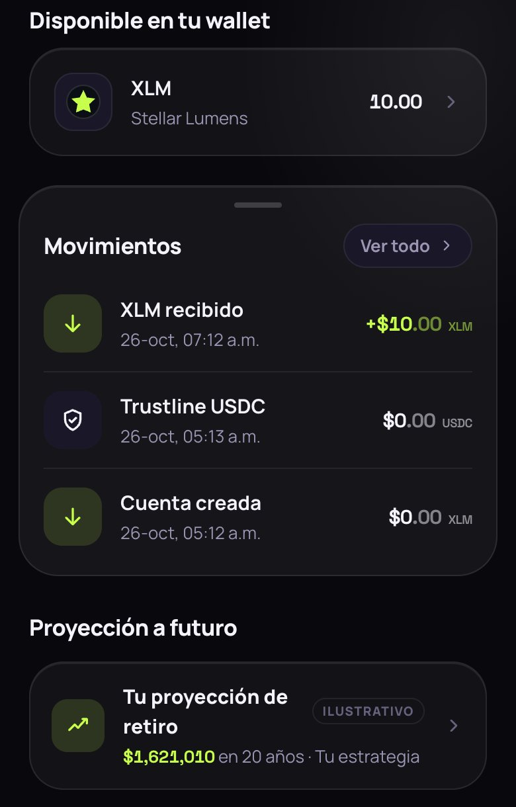

## 3. Add money (Agregar dinero)

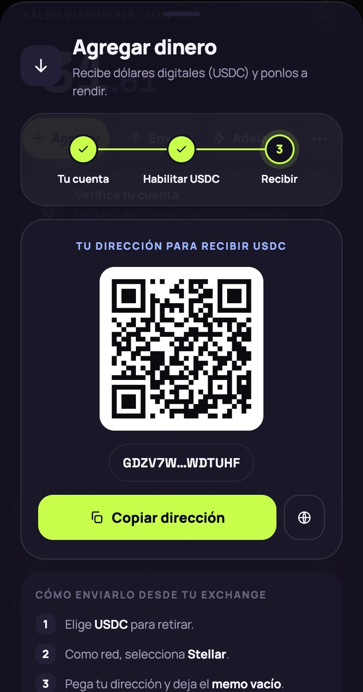

- **Live:** receive USDC on Stellar. The screen shows the user's `G…` address and a QR code, with
  the USDC trustline already enabled.
- **Coming soon:** SPEI deposits in pesos through Etherfuse. This is integrated on testnet only
  and stays behind the `SPEI_ENABLED` flag, which is off in production.

 

## 4. Send (Enviar)

- Large amount input, an asset selector (pills) and a destination `G…` address.
- The server builds the payment, the user signs it in Pollar, and our sponsor wraps it in a
  **fee-bump** and submits it. The user pays no fee.

 

## 5. Savings (Ahorro): the USDC vault

- The user's savings goals (bóvedas) are stacked as cards. Each one is a named goal backed by the
  same on-chain position in the DeFindex USDC vault.
- **Tasas de hoy** (today's rates) lists where money can earn. On mainnet only **USDC** can be
  chosen. Other assets are shown as coming soon.
- **Nueva bóveda** (new goal): the name is required and validated, and the user is warned if a goal
  with that name already exists. The name and target are stored in Supabase. **Money is never
  stored there.**
- **Abonar** (deposit): `POST /api/vault/build` returns a DeFindex `deposit` XDR. Amounts are always
  arrays, as in `[amount]`. It is simulated and assembled, signed in Pollar, fee-bumped and
  submitted. The USDC goes into the **Meru vault**, which supplies it to the **Blend** pool.
- **Retirar** (withdraw): the reverse. The vault redeems shares and pulls USDC back out of Blend.

 

| Today's rates | New goal (name required, USDC on mainnet) |
| --- | --- |
| 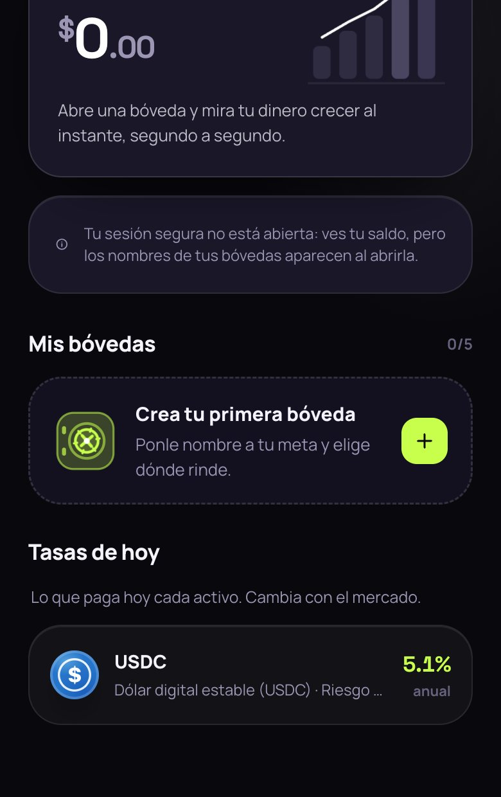 | 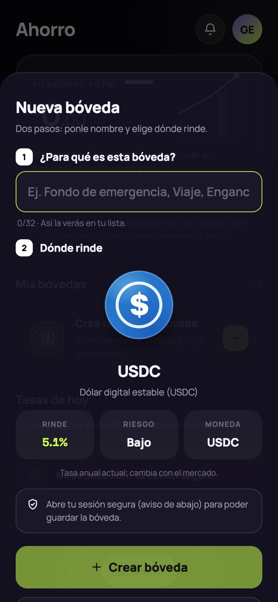 |

## 6. Yield advance (Adelanto): the part we built

This is SEYF's own primitive. A saver who needs money today can take the yield their savings
**will** earn over the next 1–30 days, **without touching the principal**.

1. **Quote.** The user picks a term with the 7, 15 or 30-day presets, or the slider.
   `GET /api/advance/quote` returns
   `A = floor(V × apy_bps × days / (10 000 × 365))`, where `V` is the current value of their vault
   shares.
2. **Open.** `open_advance` moves the user's vault shares into the contract (escrow) and pays them
   `A` USDC **from the contract's own treasury**, never from the user's principal. One position per
   user.
3. **Exit A: repay.** At any time the user returns `A` and gets **every share back**. `repay` works
   even when the contract is paused.
4. **Exit B: settle.** If the user does nothing, the shares keep earning in Blend. Once
   `V_now ≥ V_open + A`, anyone can call `settle`. Our keeper does it every 10 minutes from GitHub
   Actions. The contract withdraws `ceil(A × shares / V_now)` shares to the treasury and returns
   the rest. The user ends with their full principal, and the treasury is repaid from **real
   yield**.

 

**About the amounts.** Beta caps are 1 USDC per user and 2 USDC in total, so the real amounts on
mainnet are cents. The "Ejemplo a escala" (example at scale) card applies the same formula to a
realistic balance: 10 000 USDC for 30 days at 4 % gives 32.88 USDC. It is labelled as an example.
The mainnet hashes in the [README](../README.md#live-on-mainnet-proof) prove the mechanism.

The full contract specification, including the rules, interface, keys and limits, is in
[contracts.md](contracts.md).

## 7. What happens behind every button

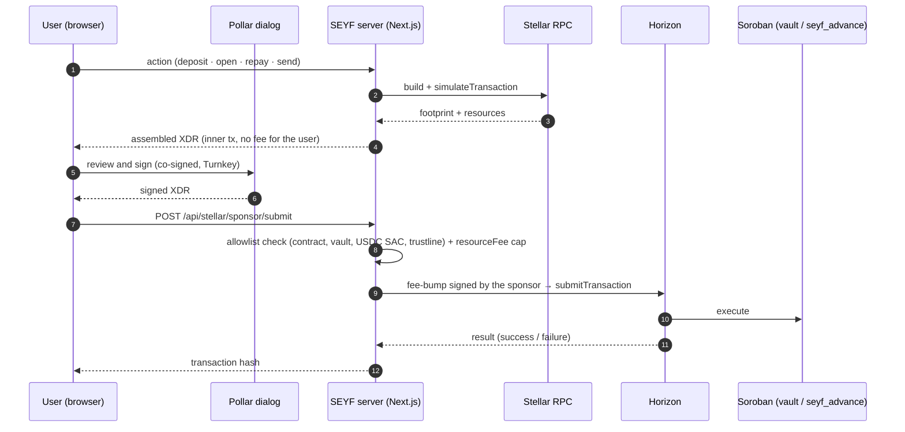

- **The server never holds funds.** It builds transactions, and it only fee-bumps operations on an
  allowlist.
- **The chain is the source of truth.** Balances come from Stellar RPC. Supabase only keeps labels
  (goal names, targets, profile) and rate-limit buckets.
- **Secrets stay on the server.** Sponsor, keeper and SEP-10 keys never use `NEXT_PUBLIC_*`, and
  the contract admin key never touches a server.

## 8. The landing page (vision, not all of it is live)

[www.seyf.app](https://www.seyf.app) is available in Spanish, English and Portuguese. It tells the
whole product story. **Only the USDC savings and the advance are live on mainnet.**

| | |
| --- | --- |
|  | 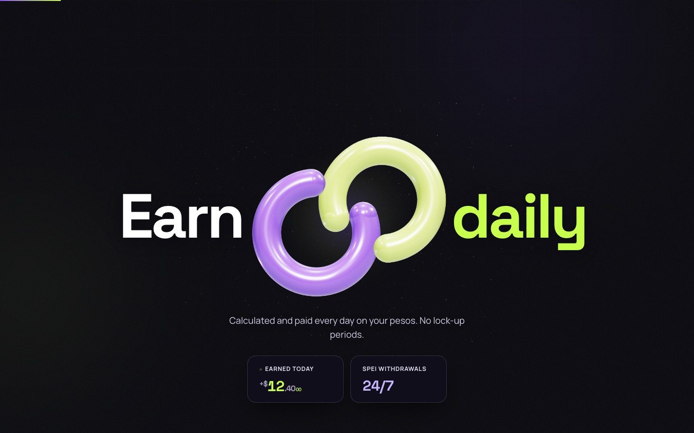 |
| **Hero:** savings that pay you today | **Earn daily:** live (USDC vault) |
| 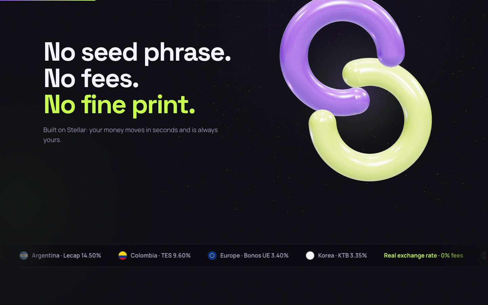 | 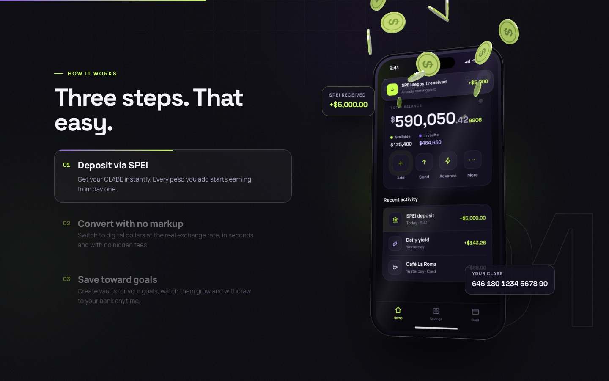 |
| **No seed phrase:** live (Pollar + sponsored fees) | **Three steps:** sign in, deposit, earn |
| 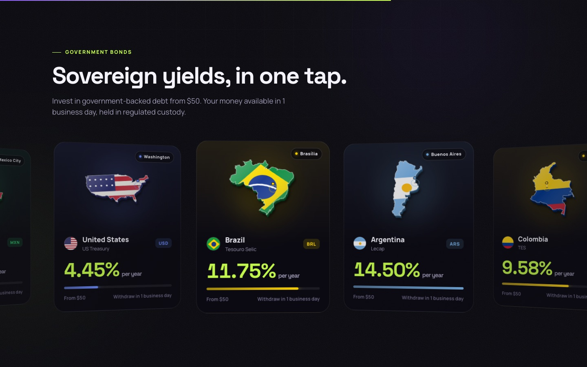 | 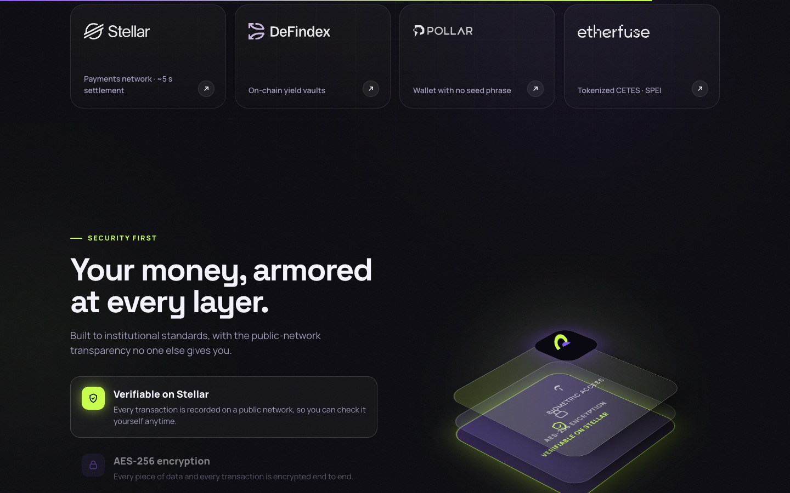 |
| **Sovereign bonds:** vision, *not live* | **Security and ecosystem:** the partners we build on |
| 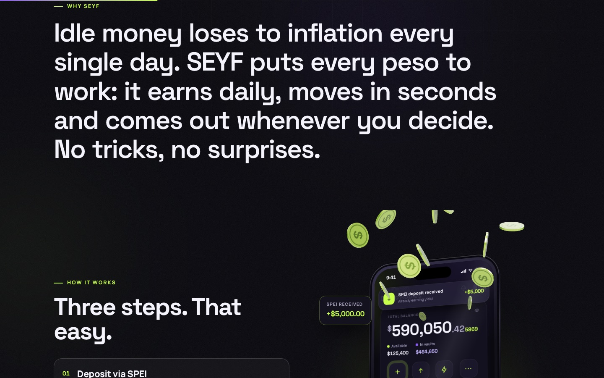 | 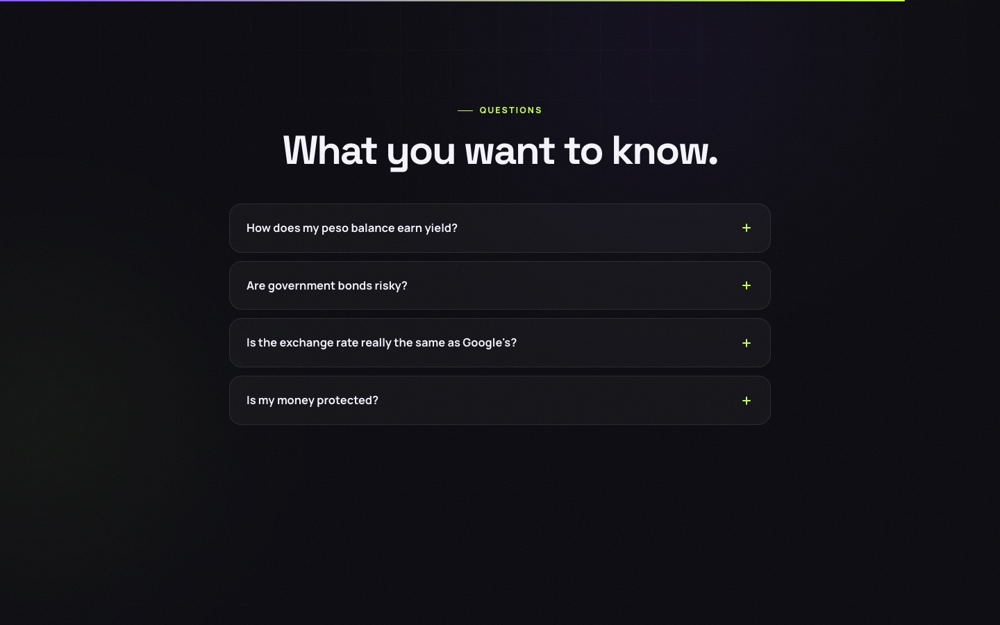 |
| **Why SEYF** (SPEI deposits and peso conversion are *coming soon*) | **FAQ** |

Mobile:

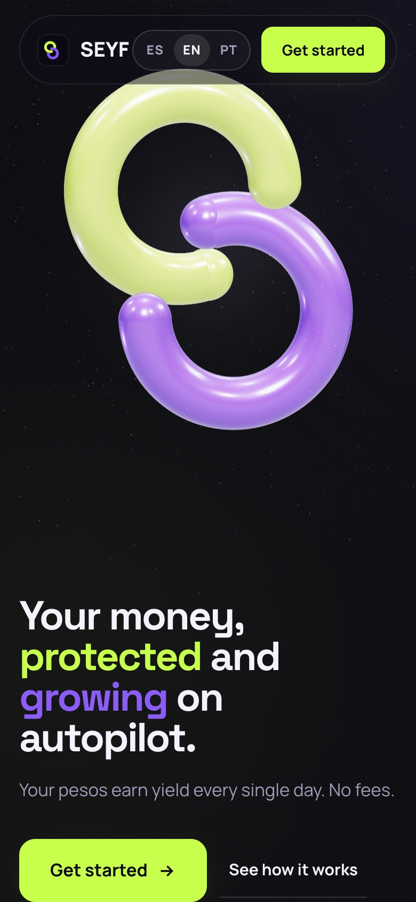 
